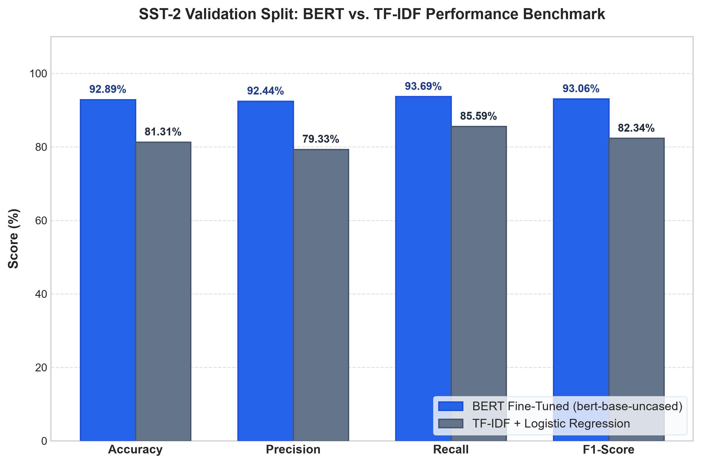
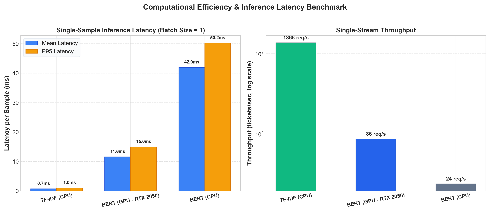
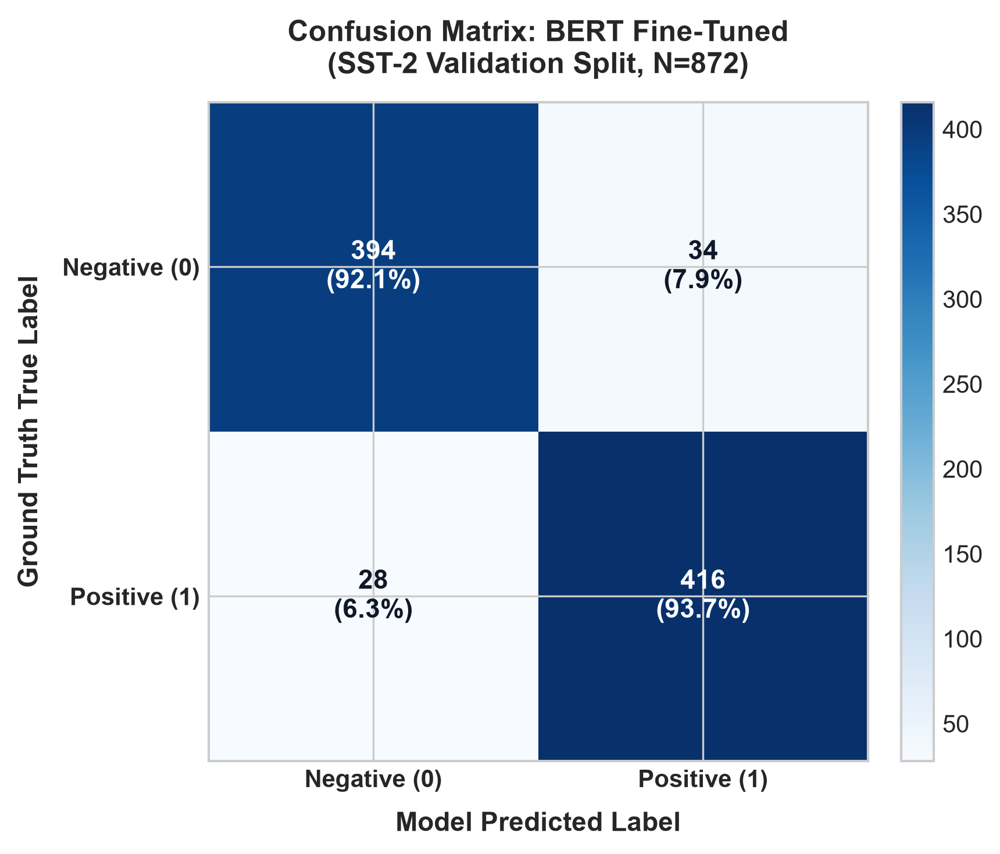
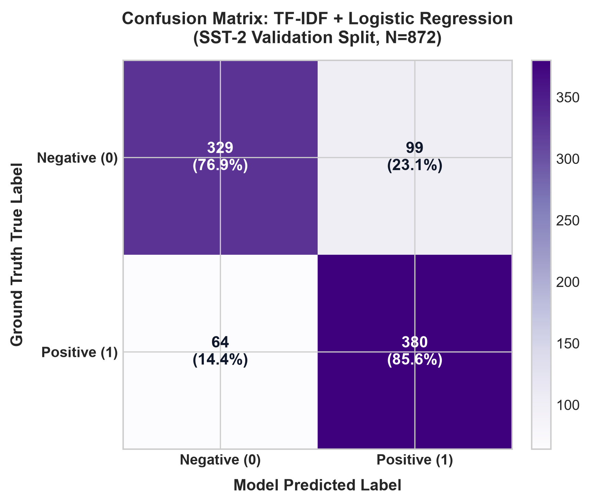

# Support-Ticket Sentiment Classifier

[](https://www.python.org/downloads/)
[](https://pytorch.org/)
[](https://huggingface.co/transformers/)
[](https://fastapi.tiangolo.com/)
[](https://nextjs.org/)
[](LICENSE)

An end-to-end, production-oriented sentiment classification system designed to analyze and classify inbound customer support tickets into positive and negative sentiments for intelligent triage, priority routing, and customer satisfaction (CSAT) monitoring.

---

## Project Overview: BERT Fine-Tuning vs. TF-IDF Baseline

This repository compares two distinct NLP paradigms on the official **GLUE SST-2 (Stanford Sentiment Treebank)** benchmark ($67,349$ training sentences, $872$ validation sentences):

1. **TF-IDF + Logistic Regression:** Classical n-gram bag-of-words baseline ($10,000$ features, $L_2$ regularization).
2. **BERT Fine-Tuning (`bert-base-uncased`):** Pretrained 110M parameter bidirectional transformer fine-tuned for sequence classification on GPU with mixed precision (`fp16`).

The complete, evidence-based 14-section evaluation report is available at [`docs/model_comparison_report.md`](docs/model_comparison_report.md).

---

## Tech Stack

- **Frontend:** Next.js 14 (App Router), React, JavaScript, Tailwind CSS, Axios, Lucide Icons
- **Backend:** Python 3.11, FastAPI, Uvicorn, Pydantic v2
- **Machine Learning & NLP:**
  - Hugging Face `transformers` (`bert-base-uncased`, `Trainer`, `TrainingArguments`)
  - Hugging Face `datasets` (Official GLUE SST-2 benchmark)
  - `torch` (PyTorch with CUDA 12.4 hardware acceleration)
  - `scikit-learn` (TF-IDF Vectorizer, Logistic Regression, Evaluation Metrics)
  - `joblib` (Scikit-learn pipeline serialization)
  - `scipy` (McNemar's statistical significance testing)
  - `matplotlib` (Publication-quality figure generation)

---

## Folder Structure

```
support-ticket-sentiment-classifier/
│
├── artifacts/                    # Production-ready model artifacts & metadata
│   ├── bert/                     # Fine-tuned BERT model (config.json, model.safetensors, tokenizer)
│   ├── tfidf/                    # Fitted TF-IDF baseline (tfidf_logistic_regression.joblib)
│   └── model_metadata.json       # Provenance, hyperparams, architecture, and metrics
├── frontend/                     # Next.js frontend project (React, JS, Tailwind CSS, Axios)
│   ├── app/                      # App router pages (/, /analyze, /model, /performance, /about)
│   ├── components/               # UI components (LiveAnalyzer, Comparison, TechStrip, etc.)
│   └── services/api.js           # REST API client
├── backend/                      # FastAPI backend project
│   ├── main.py                   # REST API routes (/api/v1/health, /api/v1/predict)
│   ├── requirements.txt          # Backend dependencies
│   └── app/services/             # Production backend services
│       └── model_loader.py       # Production singleton model loader & inference service
├── data/                         # Dataset storage and scripts
│   ├── sst2/                     # Official SST-2 GLUE benchmark dataset splits (train, validation)
│   └── download_sst2.py          # Script to download official SST-2 dataset
├── models/                       # Checkpoints and base models
│   ├── bert/                     # Pretrained BERT base weights & vocab
│   ├── bert-sst2/                # Fine-tuned BERT checkpoint
│   └── tfidf_baseline.joblib     # Serialized baseline pipeline
├── training/                     # Model training & verification scripts
│   ├── bert_finetuning.ipynb     # Interactive fine-tuning notebook
│   ├── compare_models.py         # Empirical comparison & latency benchmark pipeline
│   └── verify_saved_models.py    # Production model sanity & verification runner
├── docs/                         # Project documentation & benchmark artifacts
│   ├── model_comparison_report.md# Comprehensive 14-section evaluation report
│   ├── evaluation_results.json   # Full empirical results export
│   └── figures/                  # Publication-quality benchmark visualizations
│       ├── metric_comparison_barchart.png
│       ├── bert_confusion_matrix.png
│       ├── tfidf_confusion_matrix.png
│       └── latency_comparison_barchart.png
├── train_runner.py               # Background GPU execution runner for BERT fine-tuning
├── training_results_summary.json # Machine-readable metrics summary
├── requirements.txt              # Core project dependencies (Transformers, Torch, Scikit-Learn)
├── .gitignore                    # Git ignore rules for venv, node_modules, datasets, weights
└── README.md                     # Project overview, setup, and run instructions
```

---

## Empirical Benchmark Results

Evaluated on the official **GLUE SST-2 validation split** ($N = 872$ sentences; $444$ positive, $428$ negative) without data leakage:

### 1. Comparison Table (Actual Measured Metrics)

| Metric | BERT Fine-Tuned (`bert-base-uncased`) | TF-IDF + Logistic Regression | Absolute Delta ($\Delta$) | Superior Model |
| :--- | :---: | :---: | :---: | :---: |
| **Accuracy** | **0.9289 (92.89%)** | 0.8131 (81.31%) | **+11.58%** | **BERT** |
| **Precision (Positive, Class 1)** | **0.9244 (92.44%)** | 0.7933 (79.33%) | **+13.11%** | **BERT** |
| **Recall (Positive, Class 1)** | **0.9369 (93.69%)** | 0.8559 (85.59%) | **+8.10%** | **BERT** |
| **F1-Score (Positive, Class 1)** | **0.9306 (93.06%)** | 0.8234 (82.34%) | **+10.72%** | **BERT** |
| **Specificity (Negative TNR)** | **0.9206 (92.06%)** | 0.7687 (76.87%) | **+15.19%** | **BERT** |
| **Negative Predictive Value (NPV)** | **0.9336 (93.36%)** | 0.8372 (83.72%) | **+9.64%** | **BERT** |
| **False Positive Rate (FPR)** | **0.0794 (7.94%)** | 0.2313 (23.13%) | **-15.19% (65.7% fewer FP)** | **BERT** |
| **False Negative Rate (FNR)** | **0.0631 (6.31%)** | 0.1441 (14.41%) | **-8.10% (56.2% fewer FN)** | **BERT** |
| **Single-Sample Latency (GPU, RTX 2050)** | **11.59 ms** (P95: 14.96 ms) | N/A (CPU bound) | — | TF-IDF |
| **Single-Sample Latency (CPU)** | 41.96 ms (P95: 50.20 ms) | **0.73 ms** (P95: 1.02 ms) | -41.23 ms | **TF-IDF (57.3× faster)** |
| **Single-Stream Throughput** | 86.3 req/s (GPU) / 23.8 req/s (CPU) | **1,365.5 req/s (CPU)** | — | **TF-IDF (15.8× higher)** |
| **Total Model Errors ($N=872$)** | **62 errors (7.11%)** | 163 errors (18.69%) | **-101 errors** | **BERT (-61.96% errors)** |

### 2. Statistical Significance Testing

A paired **McNemar's test** with Edwards continuity correction between BERT and TF-IDF predictions on the 872 validation sentences yielded:
- **$\chi^2$ Statistic:** $63.6943$
- **$p$-value:** **$1.4531 \times 10^{-15} \ll 0.001$**

The performance difference is statistically significant, formally rejecting the null hypothesis of equal marginal performance.

### 3. Confusion Matrix Breakdown

```
BERT Fine-Tuned:                         TF-IDF + Logistic Regression:
                  Predicted                               Predicted
               Neg (0)   Pos (1)                       Neg (0)   Pos (1)
Actual Neg (0)   394       34           Actual Neg (0)   329       99
Actual Pos (1)    28      416           Actual Pos (1)    64      380
```

- **Critical False Positive Reduction:** In automated customer support triage, a False Positive misclassifies an angry/churn-risk customer as positive. TF-IDF made $99$ False Positives ($23.1\%$ error rate), whereas BERT reduced this by **$65.66\%$** down to $34$ ($7.9\%$ error rate).

---

## Visualizations

All publication-quality charts are programmatically generated and stored in [`docs/figures/`](docs/figures/):

| Metric Comparison Bar Chart | Single-Sample Latency & Throughput |
| :---: | :---: |
|  |  |
| *Figure 1: Accuracy, Precision, Recall, and F1 on SST-2.* | *Figure 2: Latency (mean & P95) and request throughput.* |

| BERT Confusion Matrix Heatmap | TF-IDF Confusion Matrix Heatmap |
| :---: | :---: |
|  |  |
| *Figure 3: BERT validation heatmap (92.1% TNR, 93.7% TPR).* | *Figure 4: TF-IDF validation heatmap (76.9% TNR, 85.6% TPR).* |

---

## Production Model Artifacts & Serving

### 1. Artifact Storage Locations

Both models and their configuration metadata are saved under [`artifacts/`](artifacts/) for production serving:

| Component | Storage Path | Key Files & Artifacts | Purpose |
| :--- | :--- | :--- | :--- |
| **Fine-Tuned BERT** | `artifacts/bert/` | `config.json`, `model.safetensors` (417.67 MB), `tokenizer.json`, `tokenizer_config.json` | 110M parameter sequence classifier with subword tokenization and explicit binary label mappings (`0: NEGATIVE`, `1: POSITIVE`). |
| **TF-IDF Baseline** | `artifacts/tfidf/` | `tfidf_logistic_regression.joblib` (455.83 KB) | Scikit-learn `Pipeline` encapsulating fitted `TfidfVectorizer(ngram_range=(1,2), max_features=10000)` and `LogisticRegression(C=1.0)`. |
| **Model Metadata** | `artifacts/` | `model_metadata.json` | Full experiment provenance, architecture dimensions, hyperparams, library versions, git commit, and validation metrics. |

> [!SECURITY]
> **Joblib Security Advisory:**
> Loading `.joblib` files relies on Python's pickle protocol which can execute arbitrary code upon deserialization. Only load joblib artifacts originating from trusted, authentic repositories.

### 2. Standalone Model Verification

You can verify that both saved models can be loaded into memory and execute valid predictions by running:

```powershell
# Windows PowerShell
.\.venv\Scripts\python training/verify_saved_models.py

# Linux / macOS
python training/verify_saved_models.py
```

The script evaluates boundary conditions on sample sentences, confirms `model.eval()` mode, measures inference latency, checks probability normalizations ($P \in [0, 1]$), and exits with code `0` on success.

### 3. How the FastAPI Backend Loads Artifacts

The FastAPI backend uses the singleton loader in [`backend/app/services/model_loader.py`](backend/app/services/model_loader.py):
- **Startup Singleton:** Models are loaded into memory once during application startup, preventing disk I/O bottlenecks during live requests.
- **Hardware Acceleration:** Auto-detects and uses CUDA when available, falling back to CPU gracefully.
- **Low-Overhead Execution:** Evaluates predictions inside `torch.inference_mode()`.
- **Fail-Fast Protection:** Raises explicit `FileNotFoundError` if artifacts are missing, preventing silent fallbacks to untrained models.

```python
from backend.app.services.model_loader import get_model_service

# Retrieve singleton instance (preloaded on startup)
model_service = get_model_service()

# Fast inference with probabilities and confidence scores
result = model_service.predict("The issue was resolved immediately, thank you!", model_type="bert")
# Returns: {'sentiment': 'POSITIVE', 'confidence': 0.9992, 'probabilities': {...}, 'latencyMs': 12.5}
```

---

## Dataset & Domain Limitation Disclosure

> [!IMPORTANT]
> **Domain Shift Warning:**
> The empirical results in this benchmark were derived entirely from the **GLUE SST-2 dataset**, which consists of single-sentence movie reviews from Rotten Tomatoes.
> 
> **High performance on SST-2 does not guarantee equivalent performance on real-world customer support tickets.**
> 
> Real-world customer support tickets exhibit distinct characteristics:
> - **Domain Vocabulary:** Technical error codes, billing terms, stack traces, and software bug IDs.
> - **Mixed Affect:** Polite greetings (*"Dear team..."*) masking severe technical grievances (*"...database is down for 6 hours"*).
> - **Multi-Sentence Length:** Inbound tickets span multiple paragraphs with logs and screenshots.
> - **Neutral Class Need:** Support queues receive many purely transactional or informational questions that require a `NEUTRAL` class, whereas SST-2 is binary.
> 
> **Recommendation:** Before deploying to production, validate the model on an annotated sample of $1,000\text{–}5,000$ actual customer support tickets and evaluate a hybrid routing or distilled architecture (e.g., DistilBERT or ONNX-quantized BERT) for optimal cost-accuracy trade-offs.

---

## Environment Setup & Running Instructions

### 1. Python Virtual Environment

```bash
# Windows PowerShell
python -m venv .venv
.\.venv\Scripts\Activate.ps1

# Linux / macOS
python -m venv .venv
source .venv/bin/activate
```

### 2. Install Project Dependencies

```bash
pip install -r requirements.txt
```

*For NVIDIA GPU acceleration (CUDA 12.4):*
```bash
pip install torch --index-url https://download.pytorch.org/whl/cu124
```

### 3. Verify Saved Production Models

```bash
python training/verify_saved_models.py
```

### 4. Rerun Comparative Benchmarking & Generate Figures

```bash
python training/compare_models.py
```

### 5. Run Backend Server (FastAPI)

```bash
# Windows PowerShell
.\.venv\Scripts\uvicorn backend.main:app --reload --port 8000

# Linux / macOS
uvicorn backend.main:app --reload --port 8000
```

- Health Endpoint: [http://127.0.0.1:8000/api/v1/health](http://127.0.0.1:8000/api/v1/health)
- Interactive Swagger Docs: [http://127.0.0.1:8000/docs](http://127.0.0.1:8000/docs)

### 6. Run Frontend Dashboard (Next.js)

```bash
cd frontend
npm install
npm run dev
```

- Web Application: [http://localhost:3000](http://localhost:3000)
- Live Ticket Analyzer: [http://localhost:3000/analyze](http://localhost:3000/analyze)
- Performance Dashboard: [http://localhost:3000/performance](http://localhost:3000/performance)
- Model Card: [http://localhost:3000/model](http://localhost:3000/model)

---

## Dependency Compatibility & Requirements

| Package | Minimum Version | Tested Version | Notes |
| :--- | :--- | :--- | :--- |
| `python` | `>=3.10.0` | `3.11.9` | 64-bit runtime |
| `torch` | `>=2.2.0` | `2.6.0+cu124` | Compatible with CUDA 12.4+ / CPU |
| `transformers` | `>=4.38.0` | `5.17.0` | Requires `safetensors` support |
| `scikit-learn` | `>=1.4.0` | `1.9.1` | Required for TF-IDF pipeline deserialization |
| `joblib` | `>=1.3.0` | `1.4.2` | Pipeline serialization |
| `fastapi` | `>=0.110.0` | `0.115.11` | Inference API |
| `next` | `>=14.0.0` | `14.2.3` | React 18, Tailwind CSS |

---

## Author & Version Information

- **Author:** Arjun Rathod
- **Repository:** [`prakashramav/Support_ticket_sentiment_classifier`](https://github.com/prakashramav/Support_ticket_sentiment_classifier)
- **Active Feature Branch:** `feat/save-trained-models`
- **Evaluation Report:** [`docs/model_comparison_report.md`](docs/model_comparison_report.md)
- **Status:** Verified & Production-Ready
